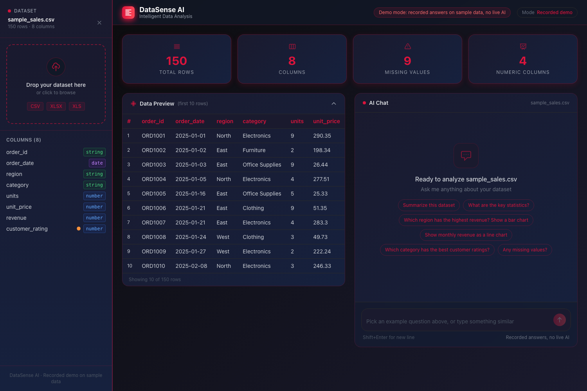
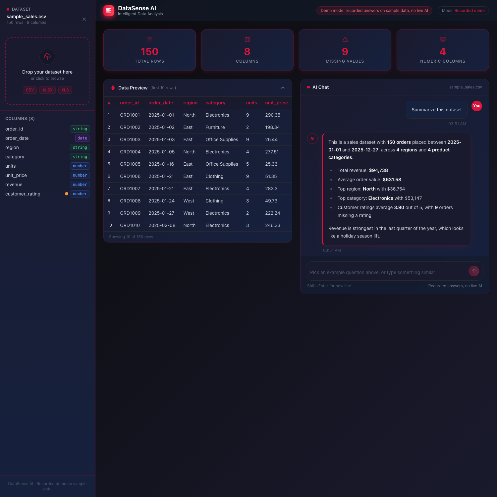
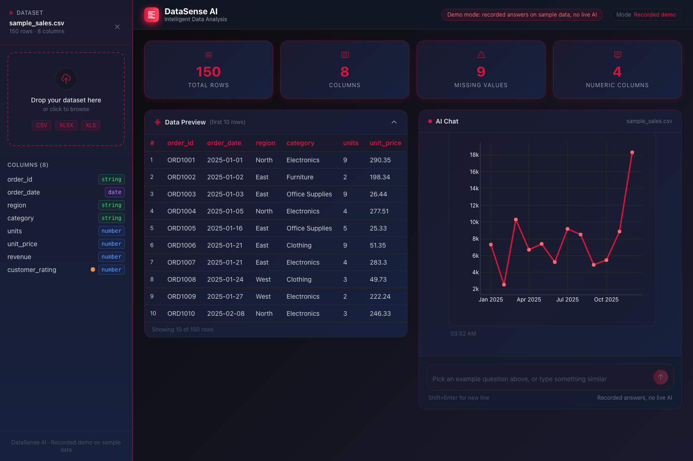

**DataSense AI: Chat With Your Data**

A web app where you upload a CSV or Excel file, ask questions in plain English and get answers with interactive charts.

Live demo: https://data-sense-chatbot.vercel.app

**Try it without any setup**

The hosted version runs in demo mode. It loads a synthetic sales dataset and replays six recorded example chats, so you can see how the product works without any live AI calls and without an API key. Pick an example question and watch the answer and chart appear.

The recorded answers are not typed by hand. A script (nextjs/scripts/generate-demo.mjs) generates the sample data and calculates every figure in the answers from it, so the demo always matches the data.

**What it does**

* Upload a CSV, XLSX or XLS file and see its shape, columns, missing values and a preview.
* Ask questions in plain English about the data.
* Get short answers with the key numbers in bold, and interactive Plotly charts on request.
* In live mode, answers come from the Claude API using a summary of the dataset. Only a summary is sent, not the whole file: column names and types, basic statistics, value counts and the first ten rows.

**Two versions**

* Next.js web app (folder nextjs): the version that is deployed. It has a demo mode and a live mode.
* Streamlit app (app_project_rutvij.py): the original Python prototype, kept for reference.

**How demo mode works**

* The app asks /api/config whether to run in demo mode. It does when no ANTHROPIC_API_KEY is set, or when DEMO_MODE is set to true.
* In demo mode the chat never calls the API. It matches your question to a recorded chat and replays it with a typing effect.
* If the config call fails, the app falls back to demo mode, so it can never make an AI call by accident.
* The chat route answers with a 503 error when no key is set.

**Run the web app locally**

1. Go to the nextjs folder and run npm install.
2. Run npm run dev and open localhost on port 3000. With no key set you get demo mode.
3. For live mode, create nextjs/.env.local containing ANTHROPIC_API_KEY with your own key. Never commit this file. It is already ignored by git.
4. To force demo mode even when a key is present, set DEMO_MODE to true.

To rebuild the sample data and recorded chats, run node scripts/generate-demo.mjs inside the nextjs folder.

**Tech stack**

Next.js 14, React 18, TypeScript, Tailwind CSS, Plotly, Papa Parse and SheetJS for file parsing, Framer Motion, and the Anthropic API for live mode. Deployed on Vercel.

**Repository layout**

* nextjs/app: pages and API routes (chat, parse, config)
* nextjs/components: chat, charts, dataset views and layout
* nextjs/hooks: chat, dataset and demo mode logic
* nextjs/lib/demo: the sample data and the matching of questions to recorded chats
* nextjs/scripts: the demo data generator
* app_project_rutvij.py: the Streamlit prototype (see requirements.txt)
* docs: extra notes and screenshots

**Author**

Rutvij Reddy Vakati, MS in Data Analytics Engineering, George Mason University.
LinkedIn: https://linkedin.com/in/vakati-rutvij-1167rutvij
GitHub: https://github.com/rutvij1407
